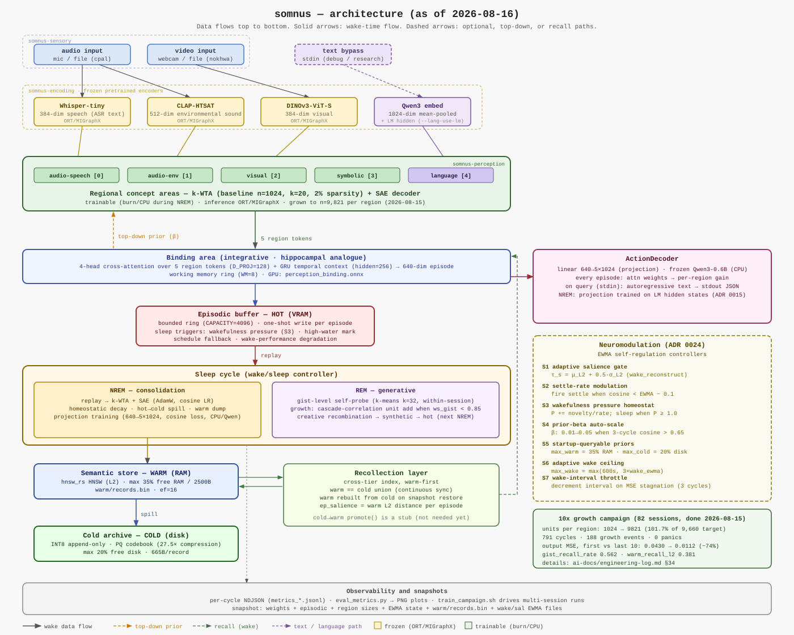

# somnus

somnus is a research project toward an AI system that keeps learning from what it sees and hears, consolidates that experience during sleep-like offline phases, and is organised after the brain at the level of algorithms rather than neurons.

## What it's trying to do

- **Learn continuously.** There is no fixed train/inference split. The system updates from experience while it runs and across sessions, and forgetting is a problem to be handled, not avoided.
- **Alternate wake and sleep.** Wake reads memory and writes new episodes. Sleep replays, consolidates, compresses, and grows capacity when recent experience can't be reconstructed.
- **Ground concepts in perception.** Audio and video come in through frozen pretrained encoders. Concepts stay tied to the experiences that produced them.
- **Grow from a small start.** The system starts with little capacity and adds units only when experience saturates it. It isn't pretrained on a large corpus.
- **Run on one machine.** The target is a single consumer GPU and workstation, not a cluster.

The full set of commitments and what is explicitly out of scope is in [`ai-docs/vision.md`](ai-docs/vision.md).



The diagram shows the wake-time data flow from sensors to memory, the regional concept areas and their binding, the three memory tiers, the sleep cycle, and the action decoder. The numbers in it are sourced in [`ai-docs/constants.md`](ai-docs/constants.md).

## Status

Research prototype. Phases 0–14 of the [roadmap](ai-docs/roadmap.md) are complete, and a 10× growth campaign ran to completion in August 2026. Live mic and webcam validation (Phase 9b) is still open. Expect rough edges and frequent churn in `scripts/`.

## Layout

- `crates/somnus` — the binary that wires everything together.
- `crates/somnus-sensory` — audio and video capture.
- `crates/somnus-encoding` — frozen encoders (Whisper-tiny, CLAP-HTSAT, DINOv3-ViT-S) via ONNX Runtime.
- `crates/somnus-perception` — k-WTA regions, binding area, and the SAE decoders.
- `crates/somnus-memory` — episodic, semantic, and cold memory, plus recall.
- `crates/somnus-metrics` — always-on and fine-grained metrics.
- `ai-docs/` — vision, architecture, constants, decisions (ADRs), research, and the engineering log. Start with [`ai-docs/README.md`](ai-docs/README.md).

## Getting started

```sh
cargo check --workspace
cargo test --workspace
```

The frozen ONNX encoders are not committed. Export them with `scripts/export_models.py` (see [`models/README.md`](models/README.md)). The binary and some tests need them to run.
